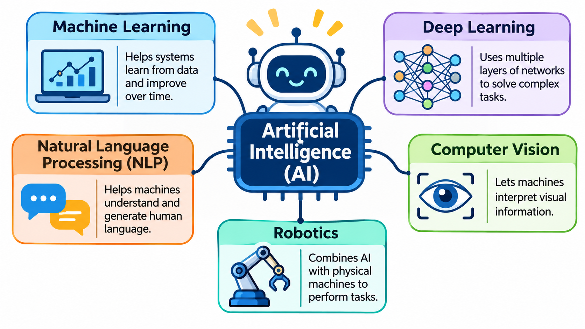

# AI Fundamentals Report

## 1. Introduction to Artificial Intelligence

Artificial Intelligence (AI) is a branch of computer science that focuses on creating machines and computer systems that can perform tasks that normally require human intelligence. These tasks include learning, problem-solving, decision-making, understanding language, and recognizing images.

AI systems use data, algorithms, and computational techniques to identify patterns and produce useful results. Today, AI is used in education, healthcare, banking, transportation, entertainment, and many other fields.

## 2. Types of Artificial Intelligence

Artificial Intelligence can be classified into three main types based on its capabilities.

**Narrow AI (Weak AI):** Narrow AI is designed to perform a specific task. It cannot perform every task like a human. Examples include voice assistants, face recognition systems, and recommendation systems.

**General AI (Strong AI):** General AI refers to a theoretical system that could understand, learn, and perform different intellectual tasks like a human being. Fully developed General AI does not currently exist.

**Super AI:** Super AI is a theoretical concept of AI that would exceed human intelligence in almost every area. It is a future possibility and does not currently exist.

## 3. Applications of Artificial Intelligence

**Healthcare:** AI helps doctors analyze medical images, identify possible diseases, and support medical decision-making.

**Education:** AI-powered learning applications provide personalized learning experiences, answer student questions, and help teachers prepare learning materials.

**Banking:** AI is used to detect suspicious transactions, identify fraud, and provide customer support through chatbots.

**Transportation:** AI supports navigation, traffic prediction, route optimization, and driver-assistance systems.

**Entertainment:** Streaming platforms use AI-based recommendation systems to suggest movies, music, and videos based on user interests.

## 4. Advantages of Artificial Intelligence

- AI can process large amounts of data quickly.
- It helps reduce repetitive manual work.
- It can operate continuously without getting tired.
- It supports better decision-making through data analysis.
- It improves efficiency in different industries.
- It provides personalized recommendations and services.

## 5. Limitations of Artificial Intelligence

- Developing and maintaining AI systems can be expensive.
- AI results depend on the quality of the available data.
- AI systems may produce incorrect or biased results.
- Excessive automation may affect some job opportunities.
- AI systems can create privacy and security concerns.
- AI does not have human emotions or common sense in the same way people do.

## 6. Real-World Examples of AI

Examples of AI in everyday life include Google Maps for route suggestions, voice assistants for understanding spoken commands, facial recognition for identifying faces, and ChatGPT for answering questions using natural language processing.

## 7. Conclusion

Artificial Intelligence is an important technology that is changing the way people live, learn, and work. It helps solve problems, automate tasks, and improve services across different industries. Although AI has limitations and challenges, its responsible use can provide many benefits to society.
